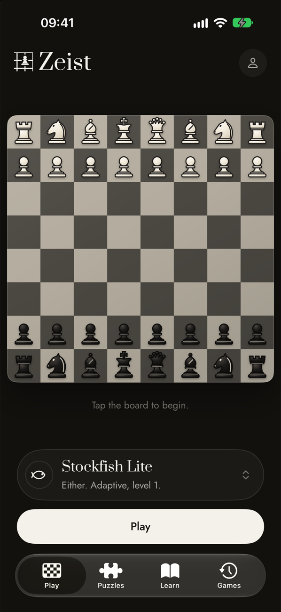
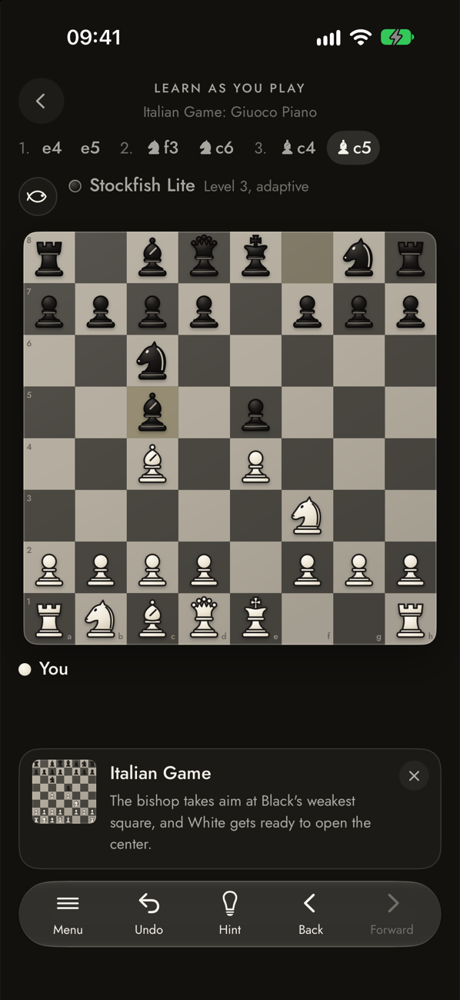
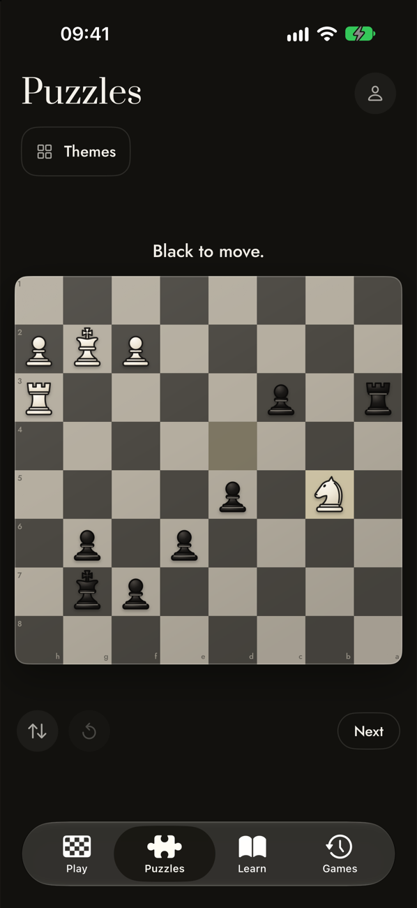
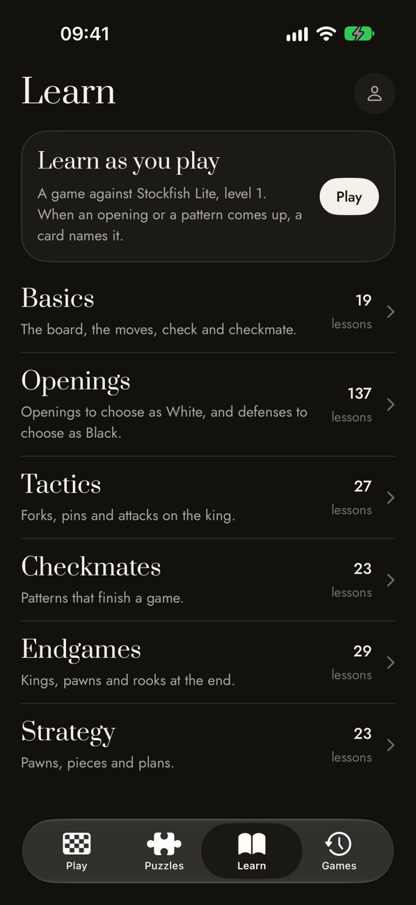

# Zeist Chess

Play Stockfish, Maia and ten other open chess engines on your own device, solve puzzles, and learn the game from the first move up.

Zeist Chess is the open-source chess app in the [Zeist](https://zeist.gg) family, for iPhone, iPad and the web. You play engines, not people. Every engine runs on your own device, and none of them runs on a server.

<p>
  
  
  
  
</p>

## What it does

- Twelve engines: Stockfish, Maia and ten more. Each plays with no network once it is on your device.
- Adaptive play starts easy and settles on your level within a few games. You can also pick a level from 1 to 10, or set an engine's own rating where it has one.
- Clocks for bullet, blitz, rapid or your own time control, with increment and premoves. No clock is the default.
- The game screen shows the line of moves, captured pieces, coordinates and the opening's name, and you can step back through the game.
- 6,995 puzzles from the Lichess set, by rating or by theme.
- Learn has 258 lessons in six courses: basics, openings, tactics, checkmates, endgames and strategy. You play every lesson on the board, and nothing is locked.
- In a game started from Learn, a card under the board names the opening you reached or the pattern that just won something, and opens its lesson. It never tells you what to play.
- Every game is kept in a log on your device that you can replay and export as PGN.
- Four boards and three piece sets, always ivory and ebony.
- You need no account. Signing in to Zeist is optional.

There are no ads, no subscription and no chat, and nothing nags you.

## The engines

| Engine | Version | By | Program | Network | Size |
|---|---|---|---|---|---|
| [Stockfish Lite](https://github.com/nmrugg/stockfish.js/tree/v19.0.1) | 19.0.1 | The Stockfish developers; WASM port by Nathan Rugg | GPL-3.0-or-later | CC0-1.0 | 1.9 MB |
| [Stockfish](https://github.com/nmrugg/stockfish.js/tree/v19.0.1) | 19.0.1 | The Stockfish developers; WASM port by Nathan Rugg | GPL-3.0-or-later | CC0-1.0 | 99.2 MB |
| [Fairy-Stockfish](https://github.com/fairy-stockfish/Fairy-Stockfish) | master e48b753 | Fabian Fichter and the Stockfish developers | GPL-3.0-or-later | none | 1.0 MB |
| [Maia 3](https://github.com/CSSLab/maia3) | Maia-3 | CSSLab, University of Toronto | AGPL-3.0 and others | GPL-3.0-only | 57.7 MB |
| [Arasan](https://github.com/jdart1/arasan-chess/tree/v26.1) | 26.1 | Jon Dart | MIT | MIT | 25.9 MB |
| [Clover](https://github.com/lucametehau/CloverEngine/tree/v9.1) | 9.1 | Luca Metehau | GPL-3.0-or-later | GPL-3.0-or-later | 14.2 MB |
| [Caissa](https://github.com/Witek902/Caissa/tree/2.0) | 2.0 | Michał Witanowski | MIT | MIT | 76.2 MB |
| [PlentyChess](https://github.com/Yoshie2000/PlentyChess/tree/b-v8.0.0) | 8.0.0 | Yoshie2000 | GPL-3.0-only | GPL-3.0-only | 53.6 MB |
| [Halogen](https://github.com/KierenP/Halogen/tree/v16) | 16 | Kieren Pearson | GPL-3.0-only | GPL-3.0-only | 19.6 MB |
| [Koivisto](https://github.com/Luecx/Koivisto/tree/v9.0) | 9.0 | Kim Kåhre and Finn Eggers | GPL-3.0-or-later | MIT | 13.0 MB |
| [Ethereal](https://github.com/AndyGrant/Ethereal/tree/v14.00) | 14.00, classical | Andrew Grant, Alayan and Laldon | GPL-3.0-or-later | GPL-3.0-or-later | 0.5 MB |
| [Zeist](engines/zeist) | 1.1 | Amrith | AGPL-3.0-or-later | none | 0.1 MB |

Each engine is the work of its authors. Zeist Chess builds each one, unmodified in how it plays, as a single-threaded WebAssembly worker. The pinned source, the patches and the license of every engine and network are in `engines/<id>/`. Only engines whose program and network both carry a clear license are included; `engines/STATUS.md` lists what was left out and why.

Every level of every engine has been measured against Maia 3, which plays like a person of a set rating; the results and the method are in [`engines/calibrate/results/`](engines/calibrate/results/README.md). The numbers are on Maia's scale, not a FIDE or Lichess rating, and level 4 of one engine is not the same strength as level 4 of another.

## How it is put together

| Folder | What |
|---|---|
| `core/` | Plain JavaScript shared by every app: the rules behind one interface, the engine host, levels and adaptive difficulty, opening names, board themes and piece sets as data. |
| `core/lessons/` | The lessons, as data, and the checker that proves every move in them. Format: [`docs/LESSONS.md`](docs/LESSONS.md). Curriculum: [`docs/LEARN.md`](docs/LEARN.md). |
| `core/learn/` | Learn as you play: the code that recognizes an opening or a pattern in a game, and the games it is tested on. |
| `engines/` | One folder per engine: a build script, patches and license notes. Built packs go to `engines/dist/`. |
| `ios/` | The iPhone and iPad app in SwiftUI. A native board; a hidden web view runs `core/` and the engines. |
| `puzzles/` | The puzzle set and its themes, from the Lichess puzzle database. |
| `web/` | Each engine's page on the web (zeist.gg/chess/vs/<id>/): plain ES modules and CSS, static files beside a small Cloudflare Worker, offline through a service worker. |
| `docs/` | How the app is put together, the engine pack contract, and how Learn and its lessons are written. |

An engine pack is a folder with a manifest, a worker script that speaks UCI one line per message, and the files it loads. The contract is in [`docs/PLAN.md`](docs/PLAN.md).

## Build

Core tests need only Node 24:

```sh
node --test core/test/*.test.js
node core/lessons/check.mjs            # every lesson: shape, legal moves, claims
node core/lessons/check.mjs --engine   # the same, with Stockfish checking every move (long)
```

The iPhone app needs Xcode and [XcodeGen](https://github.com/yonaskolb/XcodeGen), and every engine pack except full Stockfish in `engines/dist` (their programs are bundled in the app; only their networks are downloaded):

```sh
engines/build-all.sh
cd ios && xcodegen generate && open ZeistChess.xcodeproj
```

Engines need Emscripten 6.0.9; see [`engines/README.md`](engines/README.md). The web app is described in [`web/README.md`](web/README.md).

## Privacy

Engines, puzzles and lessons run on your device, and nothing needs an account. Two things leave the iPhone app unless you turn them off in Settings:

- Usage counts, through Google Analytics, built without the advertising identifier: how often the app is opened, which engines and puzzles are played, how games end. They never include your moves or your name. Where the law asks for permission first (the EEA, the UK and Switzerland), the app asks once and counts nothing until you say yes.
- Finished games against the Zeist engine, to make that engine better: the moves, the level, the result and the clock. They are sent with no account and nothing about you or your device. Signed in, the choice on your Zeist account also counts.

Signed in to a Zeist account, one more thing is shared, so your puzzles follow you between Zeist and Zeist Chess: which puzzles you solved or saw, where you are in them, and for the daily puzzle the days you finished and whether with a miss. The moves that solve a puzzle are sent to be checked and are not kept. Signed out, puzzle progress stays on the iPhone ([`ios/ZeistChess/Puzzles/PuzzleSync.swift`](ios/ZeistChess/Puzzles/PuzzleSync.swift)).

What is sent is written out in [`ios/ZeistChess/App/Measure.swift`](ios/ZeistChess/App/Measure.swift) and [`ios/ZeistChess/Log/EngineGames.swift`](ios/ZeistChess/Log/EngineGames.swift). A build you make yourself has no analytics (the configuration file is not in this repository); game sharing works the same and has the same switch.

## License

Zeist Chess is free software under the [GNU Affero General Public License, version 3 or later](LICENSE). [An additional permission](LICENSE-EXCEPTION.md) covers linking the analytics library. The lessons are also licensed to Zeist by their copyright holder ([LICENSE-LESSONS.md](LICENSE-LESSONS.md)). Each engine, network, piece set and font keeps its own license, stated beside its files and in the app's Settings.

The puzzles come from the [Lichess puzzle database](https://database.lichess.org/#puzzles) (CC0), and the opening names from [lichess-org/chess-openings](https://github.com/lichess-org/chess-openings) (CC0). The default piece set is Zeist's own; the other two are by Colin M.L. Burnett and pirouetti. The fonts are Prata and Jost (SIL Open Font License).

Zeist Chess is a side project by [Amrith](https://amrith.co). See [CONTRIBUTING.md](CONTRIBUTING.md) before sending changes.
